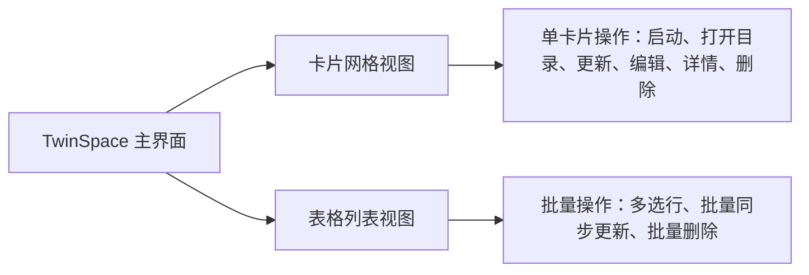

# 第一章：基础操作与分身管理

本章将手把手带您通过 7 步交互式向导创建您的第一个分身应用，并详细介绍分身的日常管理技巧，包括快速启动、一键打开数据目录、母体更新后的无损同步、表格视图批量操作与安全删除。

---

## 📑 本章目录

- [创建分身应用（7 步交互向导）](#创建分身应用7-步交互向导)
  - [步骤 1：选择母体应用](#步骤-1选择母体应用)
  - [步骤 2：规则匹配与策略确认](#步骤-2规则匹配与策略确认)
  - [步骤 3：分身命名与界面语言](#步骤-3分身命名与界面语言)
  - [步骤 4：选择安装目标目录](#步骤-4选择安装目标目录)
  - [步骤 5：设置独立数据存储目录](#步骤-5设置独立数据存储目录)
  - [步骤 6：配置独立网络代理（可选）](#步骤-6配置独立网络代理可选)
  - [步骤 7：确认配置并立即创建](#步骤-7确认配置并立即创建)
- [管理分身应用](#管理分身应用)
  - [启动分身应用](#启动分身应用)
  - [一键打开独立数据目录](#一键打开独立数据目录)
  - [编辑分身配置](#编辑分身配置)
  - [母体升级后的“无损同步更新”](#母体升级后的无损同步更新)
  - [批量操作（批量更新与批量删除）](#批量操作批量更新与批量删除)
  - [安全删除（保留数据 vs 彻底清理）](#安全删除保留数据-vs-彻底清理)
- [🗂 多 App 隔离环境](#-多-app-隔离环境)

---

## 🪄 创建分身应用（7 步交互向导）

点击 TwinSpace 主界面右上角的 **"+ 新建分身"** 按钮，即可唤起 7 步交互式创建向导。

```text
+-------------------------------------------------------------+
|  🧙 创建新分身 - 第 1 步 / 共 7 步                            |
|                                                             |
|  选择目标应用程序 (.app)                                     |
|  [/Applications/WeChat.app                   ] [ 浏览... ]  |
|                                                             |
|  [ 取消 ]                                    [ 下一步 > ]   |
+-------------------------------------------------------------+
```

### 步骤 1：选择母体应用
1. 点击 **"浏览..."** 按钮打开 macOS 原生文件选择窗口（默认定位在 `/Applications`）。
2. 选择您想要多开的应用程序（如 `WeChat.app`、`Telegram.app`、`Google Chrome.app` 或 `Cursor.app`）。
3. 点击 **"下一步 >"**。

> [!TIP]
> 您也可以直接将 `.app` 的完整路径复制并粘贴到输入框中。

---

### 步骤 2：规则匹配与策略确认
TwinSpace 会自动对所选应用进行智能探测：

* **内置规则匹配**：如果应用在内置的 33+ 热门规则库中，引擎会自动匹配最佳克隆策略（如微信默认采用“物理克隆”，Cursor 默认采用“软包装”）。
* **智能探针推荐**：如果是未预设规则的小众应用，引擎会动态扫描其二进制架构和沙盒权限，自动推荐最优策略。
* **策略切换**：您可以按需调整策略：
  * `hard_clone`（物理克隆）：完整复制 App，伪装 Bundle ID 并注入环境隔离机制。
  * `soft_clone`（软包装）：轻量启动器外壳，通过参数注入实现数据隔离。
* **注入模式 (Injection Mode)**：在物理克隆模式下，您可以精细指定环境注入技术：
  * `auto`（自动检测，默认推荐）：引擎先静态扫描 Mach-O 二进制头部 Padding 空间。原生应用空间充裕时，自动采用 **动态库无感注入 (`dylib`)**，零进程替换，完美支持顶部菜单栏图标与系统通知中心；若空间不足或需命令行参数，则自动平滑降级为 **启动器包装 (`launcher`)**。
  * `dylib`（动态库注入）：强制执行原进程动态库注入。如头部空间不足，向导将明确报警避免损坏二进制。适合微信、Telegram 等原生通信软件。
  * `launcher`（启动器包装）：强制采用编译原生 Mach-O C 语言启动器并备份 `.bin` 的传统方案。

点击 **"下一步 >"** 继续。

---

### 步骤 3：分身命名与界面语言
为您的分身应用配置独立的身份：

```text
分身代号:     [ WeChat2                         ]  (用于内部目录与配置文件命名)
显示名称:     [ 微信工作版                       ]  (显示在 Dock、聚焦搜索和访达中)
界面语言:     [ 简体中文 (zh-CN)              v ]  (分身专属独立语言)
```

1. **分身代号 (Clone Name)**：字母与数字组合（如 `WeChat2`、`Telegram-Work`）。
2. **显示名称 (Display Name)**：在 macOS 程序坞 (Dock)、聚焦搜索 (Spotlight) 和访达中展示的应用名称。默认会自动跟随分身代号，您可随时自定义。
3. **界面语言 (UI Language)**：为该分身指定独立的语言环境（例如母体保持中文，分身独立运行为英文或日文）。
4. **应用图标**：默认预览并保留原应用图标。点击 **更换图标…** 选择 `.icns` 文件，或点击 **恢复原图标** 撤销选择。

**进程名称与 Clash 规则（硬分身）**：分身代号同时用于真实主进程名称，例如 `WeWork`；应用包内的 Mach-O 辅助进程使用 `WeWork-` 前缀。显示名称仍只控制 Dock/访达中的标签。Clash Meta/Mihomo 开启进程识别后，可在兜底规则前添加：

```yaml
find-process-mode: always
rules:
  - PROCESS-NAME-REGEX,^WeWork(-|$),🇸🇬 新加坡节点
```

目标节点/策略组需已存在。软分身运行的是原应用，无法独立更改其真实进程名；需要进程规则隔离时请选择 `hard_clone`。已有分身需要退出后通过新版重新创建或更新；应用包外的系统服务不在重命名范围内。

点击 **"下一步 >"**。

---

### 步骤 4：选择安装目标目录
选择新生成的分身 `.app` 安装位置：

* **默认目录（`~/TwinSpace/Apps` —— 强烈推荐）**：安装到当前用户的 TwinSpace 应用目录。**全程无需管理员密码，免 Root 提权。**
* **系统目录（`/Applications`）**：安装到系统全局应用程序目录。TwinSpace 会通过 macOS 原生授权弹窗请求一次写入权限。

点击 **"下一步 >"**。

---

### 步骤 5：设置独立数据存储目录
配置分身存放独立数据库、聊天记录、首选项和缓存的路径：

* **默认路径（`~/TwinSpace/Data/<分身名称>`）**：系统自动分配并管理的专属隔离区。
* **自定义路径 / 外接移动硬盘**：点击 **"浏览..."** 可将数据存储指定到外接 SSD 或特定加密盘。

> [!NOTE]
> 对于无需或不支持重定向数据目录的特殊命令行工具，向导会提示该项由系统默认管理。

点击 **"下一步 >"**。

---

### 步骤 6：配置独立网络代理（可选）
如果您希望该分身通过独立的代理线路访问网络（用于办公/私人网络隔离或单应用防指纹关联）：

1. 开启 **"启用独立网络代理"** 开关。
2. 选择协议类型：`HTTP`、`HTTPS` 或 `SOCKS5`。
3. 填入代理服务器地址（默认 `127.0.0.1`）与端口号（如 `7890` 或 `1080`）。

点击 **"下一步 >"**。

---

### 步骤 7：确认配置并立即创建
核对摘要卡片上的所有信息：

* **母体应用**：`/Applications/WeChat.app`
* **分身代号**：`WeChat2`
* **克隆策略**：`hard_clone`
* **安装路径**：`~/TwinSpace/Apps/WeChat2.app`
* **数据目录**：`~/TwinSpace/Data/WeChat2`
* **独立代理**：`http://127.0.0.1:7890`

点击 **"立即克隆 🚀"**。进度条将自动完成物理拷贝、Plist 基因改造、沙盒剥离、壳劫持与 Ad-hoc 本地重签名。完成后分身即可立即运行！

---

## 🎛️ 管理分身应用

TwinSpace 支持两种主视图浏览分身：**卡片网格视图 (Card Grid View)** 与 **表格列表视图 (Table View)**。



### 启动分身应用
* **从 TwinSpace 启动**：在卡片或表格行中点击 **"启动"** 按钮，或直接**双击表格视图中的分身行**。
* **从 Spotlight 聚焦搜索启动**：按下 `Cmd + 空格`，输入分身的显示名称（如 `微信工作版`）回车即可启动。
* **从访达或程序坞启动**：直接双击 `~/TwinSpace/Apps/WeChat2.app`。

---

### 一键打开独立数据目录
想要查看分身下载的文件、清理缓存或备份数据库？

* 点击分身卡片或操作栏上的 **"打开目录"**（Open Dir）按钮。
* 访达将立即打开该分身的专属存储目录（`~/TwinSpace/Data/<分身名称>`）。

---

### 编辑分身配置
需要修改分身的显示名称、界面语言或代理服务器？

1. 点击分身卡片或工具栏上的 **"编辑"** 按钮。
2. 在弹出窗口中调整：
   * **显示名称**：更改在程序坞和访达中的标题。
   * **语言环境**：切换分身界面语言。
   * **代理设置**：开启/关闭或更改代理服务器地址。
3. 点击 **"保存修改"**，下次启动分身时生效。

> **查看完整参数**：点击分身卡片或工具栏的「详情」，可以查看所属环境、完整设备身份（平台 UUID、序列号、主机名、设备种子、Keychain 前缀）、注入参数与启动命令。「所有分身」页的表格新增「所属环境」列，筛选下拉也会按环境列出。

---

### 母体升级后的“无损同步更新”
当您的母体应用（如微信）通过 Mac App Store 或官方网站完成版本升级后：

1. 打开 TwinSpace。
2. 选中需要更新的分身，点击 **"更新"**（Update）按钮。
3. TwinSpace 将自动拉取最新母体二进制重新构建分身，并**100% 完整保留您原有的所有聊天记录、登录状态与配置数据**。

> [!IMPORTANT]
> **零数据丢失保障**：由于 TwinSpace 采用了“数据与程序本体物理分离”的架构设计，重构或更新 `.app` 应用程序包绝对不会触碰您的本地数据库与聊天记录。

---

### 批量操作（批量打开 / 关闭 / 更新 / 删除）
当您管理较多分身实例时：

1. **表格视图**：使用 macOS 标准多选 —— `Cmd + 点击` 多选不连续的分身行、`Shift + 点击` 连续选择，或按住左键从一行拖动扫过若干行。
2. **卡片视图**：在网格里 **按住左键拉框**，框到的卡片全部选中（`Cmd + A` 全选、`Esc` 取消、拖到边缘自动滚动）；选中多个后 **右键** 任一选中卡片，菜单变为「打开 / 停止 / 更新选中的 N 个分身」与「取消选择」，空白处右键则是「全选 / 取消选择」。
3. 底部操作栏 / 批量操作条会自动切换为批量按钮：
   * **"打开 (N 个分身)"**：依次启动选中的分身（已在运行的分身自动跳过）。
   * **"关闭 (N 个分身)"**：退出选中分身中正在运行的进程。
   * **"更新 (N 个分身)"**：依次重新构建选中的分身，数据目录不受影响。
   * **"删除 (N 个分身)"**：一键安全清理选中的分身。

---

### 母体升级后的「待升级」标志
母体应用（如微信、Chrome）升级后，分身里仍保留着旧版本：

* **所有分身**：表格新增「版本」列，显示 `⬆ 旧版本 → 新版本`；卡片视图显示「⬆ 可升级」与版本对比行。
* **我的环境**：应用图标下方显示 `⬆ 新版本号`，环境卡片标题右侧显示「⬆ N 个待升级」。
* 点击「更新」即可把分身同步到母体版本（数据目录与登录状态保持不变）。

---

### 安全删除（保留数据 vs 彻底清理）
点击 **"删除"**（或执行批量删除）时，TwinSpace 会弹出双重确认安全对话框：

```text
+-------------------------------------------------------------+
|  ⚠️ 删除分身应用确认                                         |
|                                                             |
|  您确定要删除分身 'WeChat2' 吗？                            |
|                                                             |
|  [X] 同时彻底删除数据存储目录 (~/TwinSpace/Data/WeChat2)      |
|                                                             |
|  [ 取消 ]                           [ 确认删除 ]            |
+-------------------------------------------------------------+
```

* **保留数据（默认不勾选）**：仅从 `~/TwinSpace/Apps` 中移除 `.app` 应用程序包，聊天记录与数据库完整保存在 `~/TwinSpace/Data/` 中。后续如需恢复，随时使用同名再次克隆即可瞬间找回所有记录。
* **彻底清除（勾选复选框）**：同时删除 `.app` 应用程序包与专属数据目录，释放磁盘空间。

---

## 🗂 多 App 隔离环境

环境把多个应用分身组合在同一个账号下，并配一个专属 Chrome Profile。
`phone1` 里的应用只会打开 `phone1` 的浏览器，数据、Keychain 与 OAuth 回调
不会串到 `phone2` 或原应用。

### 创建环境（GUI）

在侧栏打开 **🗂 我的环境**，点击 **+ 新建环境**：

1. 输入环境名称（如 `phone1`）。
2. 逐个打开要加入的应用开关——每个应用会生成默认分身名
   （`应用名-环境名`），可以直接修改。
3. 点击 **创建环境**，按应用显示创建进度。

### 创建环境（CLI）

```bash
# 使用本机已安装的全部支持应用，默认命名
twinspace env create phone1

# 显式指定应用列表 + 自定义分身名
twinspace env create phone1 --apps chrome,zcode,workbuddy \
  --clone-name zcode=ZCode-phone1

# 内置模板：all / phone / dev
twinspace env create phone1 --template phone
```

### 浏览器绑定：环境 Chrome 与外部浏览器

默认情况下环境会同时克隆 **Chrome**，环境内其他应用都会绑定到这个分身——
链接、OAuth 登录与回调都会打开环境自己的浏览器，并使用环境专属 Profile
（`~/TwinSpace/Data/Environments/<名称>/Browser`）。

如需使用**外部浏览器**（不克隆 Chrome）：

```bash
# 链接用 Microsoft Edge 打开，Profile 保存在环境内（不克隆、不改动 Edge 本体）：
twinspace env create phone1 --apps zcode,workbuddy \
  --browser "/Applications/Microsoft Edge.app"

# 不带 --browser 且应用列表不含 Chrome：链接直接走 macOS 系统默认浏览器
# （不绑定、不劫持）。
twinspace env create phone1 --apps zcode

# 按应用覆盖：让某个应用复用已有的浏览器 Profile
twinspace env create phone1 --apps zcode \
  --set-env zcode=TWINSPACE_BROWSER_DATA_DIR="$HOME/Library/Application Support/Google/Chrome"
```

> [!NOTE]
> - 绑定按应用持久化保存，`env update` 与 `env export`/`import` 后依然生效。
> - 链接劫持依赖**硬克隆**（隔离钩子）；软克隆应用无法绑定浏览器。
> - `TWINSPACE_*` 隔离变量完整参考（浏览器路径、回退浏览器、Keychain
>   命名空间、OAuth scheme、HOME 钩子等）见项目
>   [中文 README](https://github.com/nineaiyu/TwinSpace/blob/main/Readme_zh.md#浏览器绑定与外部浏览器)。

### 在宿主机上使用环境浏览器

环境的 Chrome 分身是一个独立应用：从访达、Spotlight 或 Dock 启动即可用该
账号的隔离 Profile 浏览；也可以在 系统设置 → 桌面与程序坞 中把它设为
macOS 默认浏览器——浏览器分身保留 URL scheme 注册，会出现在候选列表中。
该设置在 `env update` 后依然有效。

### 环境日常操作

```bash
twinspace env list                          # 环境列表
twinspace env open phone1                   # 打开环境内全部应用
twinspace env update phone1                 # 原应用升级后批量重建
twinspace env backup phone1                 # 全部应用数据打包备份
twinspace env restore phone1 <archive.tar.gz>
twinspace env export phone1 -o phone1.yaml  # 导出可移植模板
twinspace env import phone1.yaml --name phone2
twinspace env remove phone1                 # 删除环境（会询问是否删数据）
```

GUI 中同样的操作在每张环境卡片上（**全部打开 / 全部更新 / 全部重建 / 备份数据 / 添加 App**），其余操作（导出模板、恢复备份、删除环境、在 Finder 中显示环境目录）收在卡片右上角的 **⋯** 菜单里。

* **全部更新**：只处理版本落后于源应用（图标带 `⬆`）的应用，已是最新的自动跳过；全部是最新时按钮为禁用态。
* **全部重建**：忽略版本，把环境内每个应用都从源应用重新构建一遍（用于修复损坏的副本或强制刷新）。
* 两者都会**自动跳过正在运行的应用**（确认框里会列出「运行中已跳过」的名单），并且点击后先弹**二次确认**，明确列出即将更新/重建的应用名（如 `Google Chrome, ZCode`）；数据目录不受影响。全部应用都在运行时只会提示先退出，不会执行任何操作。
环境内的 App 以「图标 + 名称」方格展示：**双击**打开，**右键**弹出菜单（打开/关闭、编辑配置、从源应用重建、在 Finder 中显示）；运行中的 App 图标下方会显示绿色状态。
多选支持与「所有分身」一致的操作：**在页面任意空白处或图标上按住左键拉出一个选择框**，框碰到的图标全部选中（拖动过程中会实时显示半透明矩形）；`Cmd + 点击` 切换单个图标，`Shift + 点击` 连续选择；**在空白处左键单击即取消全部选择**（按住 `Shift` 点击空白则保留选区）；`Cmd + A` 全选、`Esc` 取消选择（拖动过程中按 `Esc` 会撤销这次框选并恢复原选区）；把指针拖到列表上下边缘时会自动滚动，方便跨屏框选；在空白处 **右键** 可弹出「全选 / 取消选择」。窗口重新激活（例如从访达更新完母体应用切回来）时会自动重算 `⬆` 待升级标记。选中多个后，在任意选中的图标上 **右键**，菜单会变成批量操作 —— 打开选中的 N 个应用、停止选中的 N 个应用、更新选中的 N 个应用（只更新落后于源应用的，已是最新的跳过）、从源应用重建选中的 N 个应用（忽略版本，逐个重建），以及取消选择；运行中的应用会被跳过并在确认框里列出。

源应用升级后，落伍的图标下方会显示 `⬆ 新版本号`，环境标题右侧显示「⬆ N 个待升级」。
环境标题下方会显示该环境的设备 UUID 前缀与主机名，`⋯ → 设备身份…` 可查看并复制完整值；分身详情页也会列出所属环境与设备身份。

---

## ⏭️ 下一步指引

* 想要为冷门应用编写专属分身规则？请阅读 **[第二章：冷门应用规则定制与基础参数](02-advanced-custom-recipes.md)**。
* 想要深入探索软硬分身底层原理？请阅读 **[第三章：实现原理解析与高级参数全解](03-under-the-hood-and-internals.md)**。
* 遇到疑问或需要提交问题？请阅读 **[第四章：常见问题 (FAQ)、系统体检与反馈](04-faq-and-troubleshooting.md)**。
